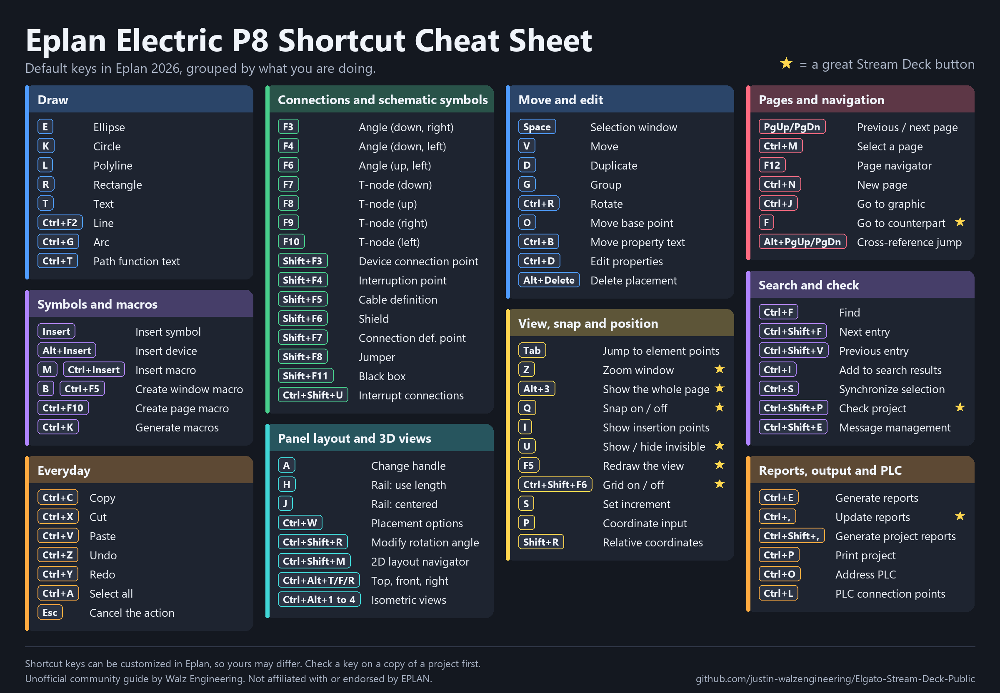
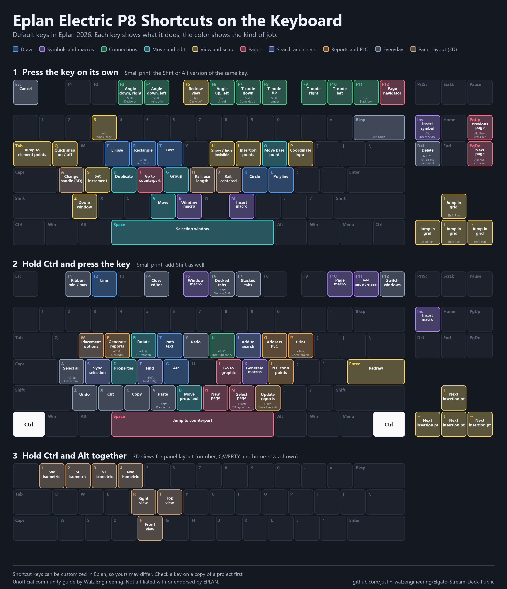

# Eplan shortcut cheat sheet

A one-page map of the keyboard shortcuts that come with Eplan Electric P8, grouped by what you are doing instead of by where the key sits. The keys are the defaults for Eplan 2026. The descriptions are written in our own words, so the wording will differ from what you see in Eplan.

Status: **Draft**. Every key was cross-checked against the default shortcut list in the Eplan help portal and a shortcut export from Eplan 2026; not every key has been run one by one yet. Shortcut keys can be customized in Eplan, so yours may differ. Try a key on a copy of a project first.

The image is drawn by [`tools/make_cheatsheet.py`](../tools/make_cheatsheet.py). Edit the `CARDS` list there to change a key or a label and run it again.

## The same keys on a keyboard

Prefer to see where each key sits? This version puts the labels right on the keys: first the keys pressed on their own (with the Shift and Alt versions in small print), then the keys pressed with Ctrl, then the Ctrl+Alt 3D views for panel layout.

It is drawn by [`tools/make_keyboard_image.py`](../tools/make_keyboard_image.py); edit the `PLAIN` or `CTRL` lists there to change a label.

## Why this belongs in a Stream Deck repo

A Stream Deck button simply sends a keyboard shortcut, so every key on this sheet is a candidate button. The stars on the image mark the ones that make the best buttons: short actions you repeat all day, or toggles you want one press away.

| Key | What it does | Why it works on a button |
|-----|--------------|--------------------------|
| Z | Zoom window | One press, then drag the area |
| Alt+3 | Show the whole page | A quick "where am I?" reset |
| Q | Quick snap on / off | Toggle you flip many times a day |
| U | Show / hide invisible elements | Toggle, handy when checking a page |
| F5 | Redraw the view | Clears display leftovers |
| Ctrl+Shift+F6 | Grid on / off | Toggle |
| F | Go to the counterpart (for example contact to coil) | Fastest way to follow a cross-reference |
| Ctrl+Shift+P | Check project | One press instead of a menu trip |
| Ctrl+, | Update reports | Already on the [profile](../profiles/) |

To put a key on a button, follow [getting-started](getting-started.md); the profile's existing buttons show the pattern. Most keys on this sheet are Eplan defaults and need no import. The profile's own buttons use the extra `Ctrl+Alt` keys listed in the [shortcut catalog](shortcut-catalog.md).

## Three keys many people miss

- **F** jumps to the matching counterpart of the item you have selected, so you can follow a cross-reference without searching.
- **Q** and **U** are quick toggles for snapping and invisible placements; both are easy to forget exist.
- **Ctrl+Shift+,** and **Ctrl+,** are different jobs: one generates the project reports, the other updates the reports you already have.

## Notes

- The sheet shows the Ctrl+Alt 3D view keys that are the same in Eplan's default list and in our shortcut file: top (`T`), front (`F`), right (`R`) and the four isometric views (`1` to `4`). Eplan's list also has bottom (`D`), left (`L`), back (`B`) and Edit workspace (`A`) on `Ctrl+Alt`, but the shortcut file the Stream Deck profile imports uses those four keys for other buttons (for example Design on `Ctrl+Alt+L`). Both cannot hold the same key, so they are left off the sheet until that is sorted out; see [IDEAS](../IDEAS.md).
- The profile's own buttons use extra `Ctrl+Alt` and `Ctrl+Shift+Alt` keys, documented in the [shortcut catalog](shortcut-catalog.md).
- The sheet also leaves out a few keys that are less useful on a button, such as the Home, End and arrow-key jumps, the Ctrl+F4 / F6 / F7 / F12 window switching and Ctrl+F1 (ribbon). The keyboard image shows some of them.
