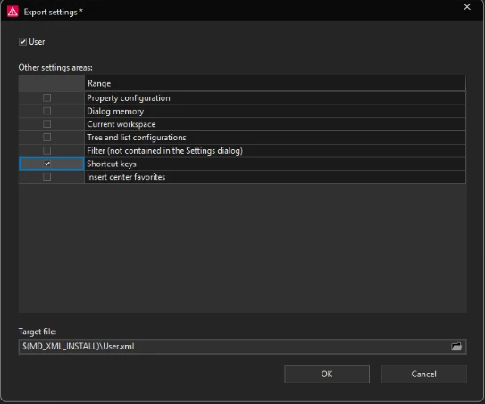
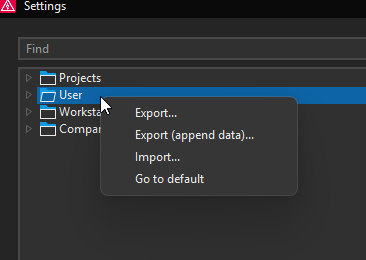

# Getting started

> The Eplan shortcut import has been tested on two accounts and works. The Stream Deck profile was built from the maintainer's setup and has been run on a fresh account.

## What you need

- A Stream Deck (any size; profiles note which model they were built for)
- Elgato Stream Deck software for Windows
- Eplan Electric P8 2026

## How it works

Each Stream Deck button sends a keyboard shortcut. For a button to do anything, **Eplan must have that shortcut assigned to the matching command**. So there are two parts: shortcuts in Eplan, then buttons on the deck.

## Part 1: Import the shortcuts into Eplan

1. **Back up your own shortcuts first.** In Eplan open Options > Settings, right-click **User**, choose **Export...**, tick **Shortcut keys** only, and save the file somewhere safe. The Import window looks the same.

   

2. Right-click **User** again and choose **Import...**.

   

3. Tick **User** and **Shortcut keys** only. Leave the other areas unticked.
4. For **Source file** pick [`eplan/ShortcutKeys_StreamDeck.xml`](../eplan/ShortcutKeys_StreamDeck.xml) and click **OK**.

> The import **replaces your whole shortcut set** with the one in the file. The backup in step 1 lets you restore yours with the same steps.

Tested: Eplan Electric P8 2026, on the maintainer's own account and on a fresh account.

### Or use the script

`scripts/ImportShortcutKeys.cs` does the same in one click: run it from File > Extras > Interfaces > Run (under Scripts), pick the shortcut file, keep **Back up my current shortcuts first** ticked, and click Import. It checks the result afterwards. Tested on Eplan 2026 (maintainer's account and a fresh account).

## Part 2: Import the Stream Deck profile

Double-click [`profiles/Eplan-Shortcuts-StreamDeck-XL.streamDeckProfile`](../profiles/Eplan-Shortcuts-StreamDeck-XL.streamDeckProfile), or in the Stream Deck app open Preferences (gear icon) > Profiles > the arrow below the list > Import. Stream Deck adds it as a new profile. See [`profiles/README.md`](../profiles/README.md) for the layout. No paths need editing: the buttons only send keyboard shortcuts.

## Try it safely

Test buttons on a copy of a project first, especially any marked as changing project data.

## Future

A one-click import script is planned; see [`../IDEAS.md`](../IDEAS.md).
