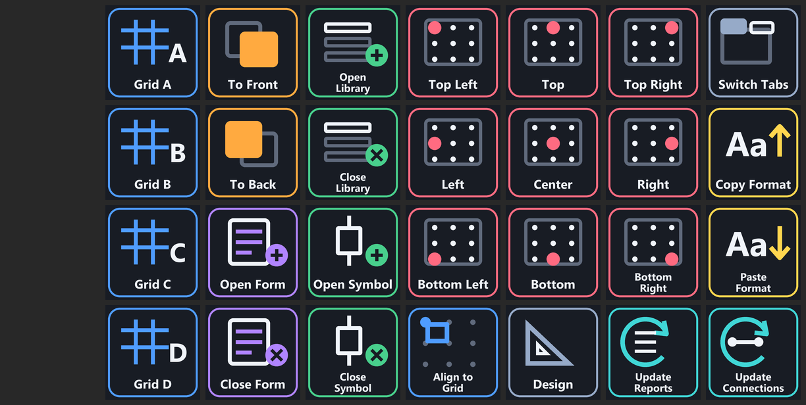

# Profiles

## Eplan Shortcuts (XL)

[`Eplan-Shortcuts-StreamDeck-XL.streamDeckProfile`](Eplan-Shortcuts-StreamDeck-XL.streamDeckProfile) is a 32-key (8 x 4) profile for the Stream Deck XL. It holds 28 Eplan buttons. The first column is left empty for your own buttons.

**Needs:** the matching shortcuts in Eplan. Import [`../eplan/ShortcutKeys_StreamDeck.xml`](../eplan/ShortcutKeys_StreamDeck.xml) first (see [getting started](../docs/getting-started.md)). Every button and its shortcut is listed in the [shortcut catalog](../docs/shortcut-catalog.md).

**Needs plugins:** only Elgato's built-in "Hotkey" and "Multi Action" actions. Nothing to install.

### Import

1. Double-click the `.streamDeckProfile` file. Stream Deck adds it as a new profile; your existing profiles are not changed.
2. Import the Eplan shortcuts if you have not already.
3. Open Eplan and press a button to try it. Test on a copy of a project first.

### Layout (column, row)

| | Row 1 | Row 2 | Row 3 | Row 4 |
|---|---|---|---|---|
| **Col 1** | free | free | free | free |
| **Col 2** | Grid A | Grid B | Grid C | Grid D |
| **Col 3** | To Front | To Back | Open Form | Close Form |
| **Col 4** | Open Library | Close Library | Open Symbol | Close Symbol |
| **Col 5** | Text Top Left | Text Top | Text Top Right | Align to Grid |
| **Col 6** | Text Left | Text Center | Text Right | Design |
| **Col 7** | Text Bottom Left | Text Bottom | Text Bottom Right | Update Reports |
| **Col 8** | Switch Tabs | Copy Format | Paste Format | Update Connections |

> Status: built from the maintainer's working setup, with generic icons. Import into a fresh Stream Deck install is still to be tested.

Other Stream Deck sizes: not yet available (see [IDEAS.md](../IDEAS.md)).
