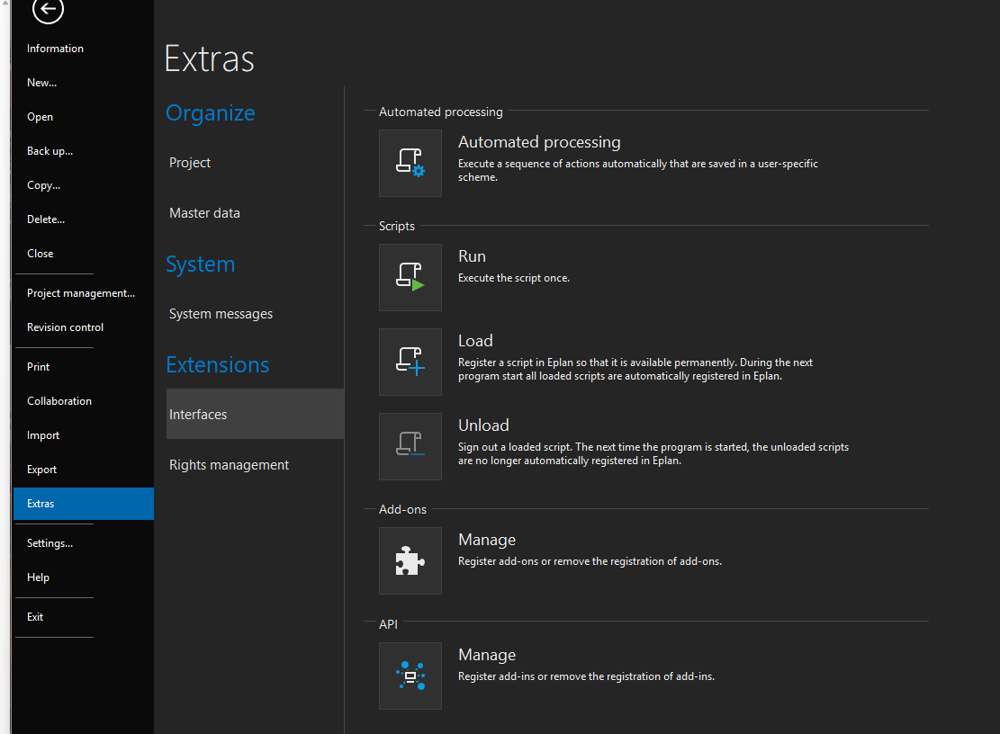
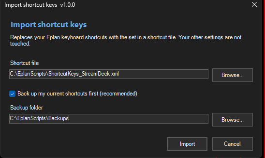
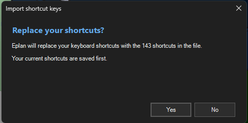
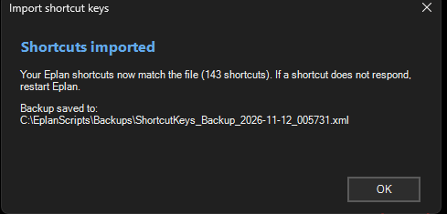

# Scripts

This folder holds the one script you run in Eplan.

New to running scripts? See [How to run a script](https://github.com/justin-walzengineering/Eplan-Scripting-GUI-Examples/blob/main/docs/running-scripts.md) in the companion Eplan Scripting GUI Examples repo.

## Import shortcut keys

| | |
|---|---|
| **File** | [`ImportShortcutKeys.cs`](ImportShortcutKeys.cs) |
| **Version** | 1.0.0 |
| **Level** | Intermediate |
| **Status** | Works. Run in Eplan 2026.0.3 on the maintainer's account and on a fresh account. |

Imports a shortcut-keys XML file (for example [`../eplan/ShortcutKeys_StreamDeck.xml`](../eplan/ShortcutKeys_StreamDeck.xml)) into Eplan in one click, so the Stream Deck buttons have the shortcuts they send.

**What it changes:** your Eplan **user** keyboard shortcuts, and nothing else. It **replaces** your whole shortcut set with the one in the file.

**How to use it**

1. Copy `ImportShortcutKeys.cs` to a folder on your computer, for example `C:\EplanScripts\`.
2. In Eplan: File > Extras > Interfaces, then **Run** (under Scripts), and choose the file.

   

3. In the window, pick the shortcut file. Keep **Back up my current shortcuts first** ticked and pick a backup folder.

   
4. Click **Import**, then **Yes** to confirm.

   

5. Read the result message. It compares the shortcuts Eplan now has with the file and says whether they match.

   

**To undo:** run the script again and choose the backup file it saved (named `ShortcutKeys_Backup_<date>_<time>.xml`).

**What you learn from the code**

- Running Eplan's settings export and import actions with parameters
- Backing up before a risky change, and stopping if the backup fails
- Checking the result afterwards instead of trusting it
- A small window that follows Eplan's light or dark theme, centered on Eplan

## Notes

- Eplan 2026 compiles scripts with C# 5, so there is no string interpolation, `?.`, or `out var` in the file.
- Try scripts on a throwaway setup first, and keep the backup the script offers.
- The two small research scripts used to find the right settings node are in [`../tools/probes/`](../tools/probes/). You do not need them.
- Want everything in one download? See the zip package described in [`../docs/releasing.md`](../docs/releasing.md).
- MIT licensed and written from scratch for this repo.
